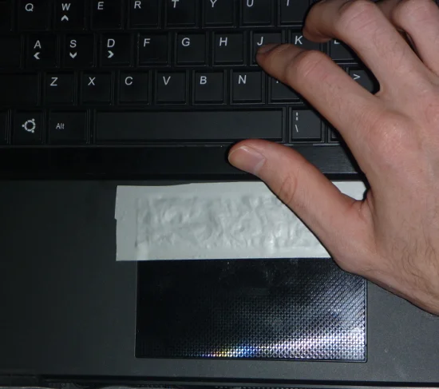

# unpalm

[](https://github.com/rpodgorny/unpalm/actions/workflows/ci.yml)
[](LICENSE)
[](https://crates.io/crates/unpalm)
[](https://aur.archlinux.org/packages/unpalm)

A Linux palm rejection filter for touchpads, written in Rust.

## Problem

Many Linux touchpad drivers don't provide adequate palm rejection, causing accidental touches when typing or resting your palms on the touchpad edges. This tool addresses that by filtering out touches that begin in configurable exclusion zones.

### The Hardware Workaround This Replaces



*Photo credit: [Lattice Point](http://www.latticepoint.org/blog/2014-9-8how-to-block-the-use-of-part-of-a-touchpad)*

Some users resort to applying duct tape and aluminum foil to physically block portions of their touchpad (conductive material is required since regular tape won't prevent capacitive touch sensors from detecting input). **unpalm provides the same functionality in software** - defining exclusion zones without the need for physical modifications.

## Why unpalm?

Existing solutions have significant limitations:

- **libinput's palm detection** is automatic, with no documented way to configure its zones, and several of its methods depend on hardware capabilities
- **libinput Lua plugins** (1.30+) can filter touches before libinput sees them, but you write the zone logic yourself, per device, and they only load if your compositor allows plugins
- **xinput/Synaptics tools** are X11-only and don't work on Wayland, which is becoming the standard
- **Driver-specific settings** (Synaptics, ELAN) vary by hardware and aren't portable across machines

unpalm solves these problems by working at the evdev level, making it compatible with any display server, any compositor, and any touchpad hardware.

## Features

- **Works everywhere** - Compatible with X11, Wayland, and any compositor (sway, Hyprland, GNOME, KDE, etc.)
- **Truly configurable** - Customize margins and exclusion zones with CLI arguments, no plugin code needed
- **Custom polygon zones** - Define arbitrary shapes (perfect for corner triangles or complex layouts)
- **Smart per-touch tracking** - Only blocks touches that start in exclusion zones, not those that move into them
- **Hardware independent** - Works with any touchpad via evdev, no driver-specific dependencies
- **Lightweight** - Single ~760KB binary with no runtime dependencies
- **Systemd integration** - Run as a user or system service for automatic palm rejection on boot

## Comparison with Alternatives

| Feature | unpalm | libinput palm detection | xinput/Synaptics |
|---------|----------------|------------------------|------------------|
| **Wayland support** | ✅ Yes | ✅ Yes | ❌ No (X11 only) |
| **X11 support** | ✅ Yes | ✅ Yes | ✅ Yes |
| **Configurable zones** | ✅ Margins + polygons | ⚠️ Lua plugin only (1.30+) | ⚠️ Rectangular edges |
| **Custom polygon zones** | ✅ Yes | ⚠️ If you script it in Lua | ❌ No |
| **Hardware independent** | ✅ Any evdev device | ⚠️ Varies by method | ❌ Driver-specific |
| **Per-touch tracking** | ✅ Yes | ✅ Yes | ❌ No (coord-based) |
| **Runtime dependencies** | ❌ None | ⚠️ libinput | ⚠️ X11 + drivers |
| **Binary size** | ~760KB | Part of libinput | N/A |

*Comparison made on 2026-10-30.*

**Key differentiators:**
- unpalm is the only ready-made Linux tool we know of that combines Wayland support, configurable polygon zones, and hardware independence
- libinput's built-in zones are fixed; changing them takes a Lua plugin written for your device and a compositor that loads plugins, while unpalm zones are plain CLI arguments and don't depend on the compositor
- Unlike xinput-based tools, it works on modern Wayland compositors (sway, Hyprland, etc.)

## Requirements

- Linux with evdev support
- Access to input devices (`input` group membership, or root)

**Note:** `sudo` is not generally needed to run unpalm. On most systems, the udev ACL rule (`80-uinput.rules`) grants the `input` group access to `/dev/uinput`. On systems where this rule is not present, `sudo` may still be required.

## Installation

**From crates.io:**
```bash
cargo install unpalm
```

**Arch Linux (AUR):**
```bash
yay -S unpalm
# or
paru -S unpalm
```

**From source:**
```bash
git clone https://github.com/rpodgorny/unpalm.git
cd unpalm
cargo build --release
sudo cp target/release/unpalm /usr/local/bin/
```

## Quick Start

Run with default settings (auto-detect touchpad, built-in exclusion zones):

```bash
unpalm
```

The tool will auto-detect your touchpad and create a filtered virtual device.

### Default Exclusion Zones

With no arguments, unpalm blocks touches starting in these zones:

```
left 30%                         right 30%
(triangle)                      (triangle)
+----------------------------------------+
|########################################|
|########################################|  <- top 20% (rectangle)
|#########/                    \#########|
|#######/                        \#######|
|#####/            OK              \#####|
|###/                                \###|
|##/                                  \##|
|#/                                    \#|
|/               OK                     \|
|                                        |
+----------------------------------------+

  # = blocked zone    OK = usable area
```

The default zones are a top 20% rectangle plus left/right 30% triangles. The triangles are wide at the top (where the top rectangle meets them) and taper to a point at the bottom corners. This shape works well because palms typically rest at the edges near the top of the touchpad.

When any `--margin-*` or `--polygon` argument is given, **all defaults are replaced** - only the explicitly specified zones apply. The `--margin-*` flags always produce rectangles; use `--polygon` for triangles or other shapes.

## CLI Options

| Option | Description |
|--------|-------------|
| `-n, --device-name <PATTERN>` | Device name pattern with wildcard support (e.g., `*ELAN*4448`) |
| `-f, --device-file <PATH>` | Device file path (e.g., `/dev/input/event5`) |
| `--margin-left <PERCENT>` | Left margin as percentage of touchpad width (rectangle) |
| `--margin-right <PERCENT>` | Right margin as percentage of touchpad width (rectangle) |
| `--margin-top <PERCENT>` | Top margin as percentage of touchpad height (rectangle) |
| `--margin-bottom <PERCENT>` | Bottom margin as percentage of touchpad height (rectangle) |
| `--polygon <POINTS>` | Polygon exclusion zone (format: `"x1,y1 x2,y2 x3,y3"` where x,y are percentages 0-100) |
| `--block-taps` | Also block taps and clicks in exclusion zones (default: only drags are blocked) |
| `--debug` | Enable debug output (individual touch events, etc.) |

**Note:** With no arguments, built-in defaults apply (30% side triangles + 20% top rectangle). When any `--margin-*` or `--polygon` is specified, all defaults are replaced. All coordinates are percentages (0-100) of the touchpad's width/height, making configurations portable across different touchpad sizes.

## Usage Examples

**Auto-detect touchpad with default exclusion zones:**
```bash
unpalm
```

**Specify touchpad by name pattern:**
```bash
unpalm -n "*Synaptics*"
```

**Custom rectangular margins (30% left/right, 15% top, 10% bottom):**
```bash
unpalm --margin-left 30 --margin-right 30 --margin-top 15 --margin-bottom 10
```

```
left 30%                         right 30%
(rectangle)                    (rectangle)
+----------------------------------------+
|########################################|  <- top 15% (rectangle)
|##########|                  |##########|
|##########|                  |##########|
|##########|   usable area    |##########|
|##########|                  |##########|
|##########|                  |##########|
|########################################|  <- bottom 10% (rectangle)
+----------------------------------------+
```

**Only a custom triangular exclusion zone (no defaults):**
```bash
# Triangle at top-left corner (coordinates are percentages: 0-100)
unpalm --polygon "0,0 20,0 10,30"
```

**Multiple polygon zones:**
```bash
# Two triangles at top corners (all coordinates are percentages 0-100)
unpalm \
  --polygon "0,0 15,0 0,25" \
  --polygon "85,0 100,0 100,25"
```

```
top-left 15x25%           top-right 15x25%
triangle                          triangle
+----------------------------------------+
|######/                          \######|
|####/                              \####|
|##/                                  \##|
|/                                      \|
|                                        |
|              usable area               |
|                                        |
|                                        |
+----------------------------------------+
```

**Specify exact device file:**
```bash
unpalm -f /dev/input/event5
```

**Also block taps and clicks in exclusion zones:**
```bash
unpalm --block-taps
```

By default, a touch starting in an exclusion zone can't move the pointer, but it can still register as a tap or click. With `--block-taps`, those are blocked too while all active touches are in blocked slots.

**Show individual touch events for troubleshooting:**
```bash
unpalm --debug
```

## Service Installation

For automatic palm rejection on boot, install as a systemd user service (recommended) or system service. See [INSTALL.md](INSTALL.md) for detailed instructions.

## How It Works

1. The tool grabs the physical touchpad device (making it unavailable to other applications)
2. Creates a virtual touchpad device with identical capabilities
3. Monitors all touch events from the physical device
4. Blocks individual touches that start within exclusion zones
5. Forwards all other events to the virtual device
6. Applications interact with the filtered virtual device instead

Touches are tracked per-slot, so if you start a touch in an allowed area, it continues to work even if you move into an exclusion zone. This provides natural palm rejection without interfering with normal touchpad use.

## Similar Projects

For transparency and completeness, here are related projects and approaches:

- [libinput palm detection](https://wayland.freedesktop.org/libinput/doc/latest/palm-detection.html) - Built-in automatic palm detection (some methods depend on hardware capabilities)
- [libinput Lua plugins](https://wayland.freedesktop.org/libinput/doc/latest/lua-plugins.html) - Scriptable event filtering in libinput 1.30+, if the compositor loads plugins; [zenbook-a16-linux-touchpad](https://github.com/wrobelda/zenbook-a16-linux-touchpad) is one example with rectangular zones for GNOME on Wayland
- [touchpadtuner](https://github.com/robertu94/touchpadtuner) - GUI for configuring xinput touchpad settings (X11 only)

**Why unpalm exists:** None of the Linux solutions above offer ready-made, configurable, polygon-based exclusion zones that work on both X11 and Wayland without hardware dependencies.

## Background

This project was built to solve a specific, immediate problem: the ASUS Zenbook Duo keyboard's palm rejection doesn't work in detached mode, making it nearly unusable. It was developed quickly and pragmatically - function over form. It works well in practice, but the codebase prioritizes directness over elaborate abstraction. Contributions and improvements are welcome.

## Related Files

- [INSTALL.md](INSTALL.md) - Detailed installation and systemd service setup
